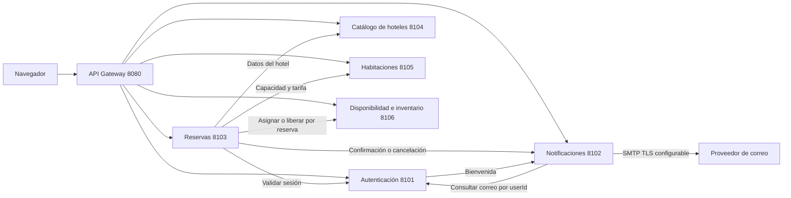

# Hotels

Proyecto universitario del Sistema de Reservas Hoteleras, proyecto 6. Esta versión actualiza el boceto HTML/CSS, utiliza referencias de hoteles reales de Montería e incorpora autenticación, reservas, notificaciones, catálogo de hoteles, habitaciones y disponibilidad e inventario mediante seis microservicios locales.

Los establecimientos no participan en la aplicación. Las reservas, tarifas, cupos y capacidades del ejercicio son simulados. Las fotografías de Unsplash son ilustrativas; no muestran los hoteles de Montería mencionados. No se contacta a los hoteles ni se cobran pagos.

## Iniciar en Windows

1. Extrae la carpeta completa.
2. Ejecuta `INICIAR.cmd`. Requiere Python 3.12 o superior; también reconoce el Python incluido en este equipo con Codex.
3. Abre <http://127.0.0.1:8080>. El iniciador abre esa dirección automáticamente cuando se ejecuta desde INICIAR.cmd.
4. Registra una cuenta y realiza una reserva de práctica.
5. Consulta «Mis reservas» y la campana de notificaciones. Los mensajes pueden tardar unos segundos en aparecer.

Mantén abierta la consola. Ctrl+C detiene todos los servicios. Para iniciarlo manualmente: `python start.py`. No requiere instalar dependencias de Python.

Puedes abrir `web/index.html` directamente para revisar el diseño. Para usar autenticación, reservas y notificaciones debes ejecutar el iniciador. Las fotografías y Google Fonts requieren conexión a internet.

## Configurar correo SMTP

Copia `.env.example` a `.env` y completa los valores de tu proveedor:

```dotenv
SMTP_HOST=smtp.tu-proveedor.com
SMTP_PORT=587
SMTP_SECURITY=starttls
SMTP_USER=tu-cuenta
SMTP_PASSWORD=tu-contrasena-de-aplicacion
SMTP_FROM=correo-autorizado@tu-dominio.com
```

Para puerto 465 usa `SMTP_SECURITY=ssl`. Se valida el certificado TLS del servidor. Utiliza un remitente permitido y la contraseña de aplicación que indique el proveedor. Nunca incluyas `.env` en Git ni en la entrega compartida.

Reinicia Hotels después de modificar `.env`. No hay que escribir credenciales dentro del HTML o JavaScript. Si falta SMTP_HOST, SMTP_USER, SMTP_PASSWORD o SMTP_FROM, los mensajes se guardan como «Vista previa» y no salen del equipo. Al configurar SMTP solo se envían los mensajes nuevos; las vistas previas anteriores no se reenvían automáticamente.

La aplicación genera avisos de bienvenida, confirmación y cancelación. Reservas envía el identificador del usuario; Notificaciones consulta el correo en Autenticación. El navegador no decide el destinatario del aviso ni puede acceder a los mensajes de otras cuentas.

«Aceptado por el servidor SMTP» indica aceptación por el proveedor, no entrega comprobada en la bandeja de entrada. Los errores de entrega se reintentan hasta cinco veces y el estado puede consultarse en Notificaciones. Si SMTP está configurado, registrar una cuenta o una reserva puede enviar un correo real al usuario; utiliza cuentas de prueba bajo tu control.

Se preparó `.env` con el servidor público de Gmail; no se completaron usuario, contraseña ni remitente. Se verificó la cola local y sus destinatarios; la entrega a un proveedor externo queda pendiente de tus credenciales.

## Seis microservicios implementados

- **Autenticación**, puerto 8101: cuentas, sesiones y correo del usuario. Base `auth.sqlite3`.
- **Reservas**, puerto 8103: propietario, fechas, huéspedes, estado e importe confirmado. Base `reservations.sqlite3`.
- **Notificaciones**, puerto 8102: eventos, destinatario obtenido en Auth y entrega SMTP. Base `notifications.sqlite3`.
- **Catálogo de hoteles**, puerto 8104: establecimientos, direcciones, descripciones, fuentes y créditos de fotografías. Base `catalog.sqlite3`. No almacena habitaciones, precios o disponibilidad.
- **Habitaciones**, puerto 8105: tipos de habitación, hotel al que pertenecen, capacidad y precio simulado. Base `rooms.sqlite3`.
- **Disponibilidad e inventario**, puerto 8106: unidades por tipo, ocupación por noche, asignación y liberación idempotentes. Base `availability.sqlite3`.

El **API Gateway**, puerto 8080, sirve la web y enruta sus peticiones. Es un componente adicional; no se cuenta dentro de los seis servicios de negocio.

Cada servicio tiene proceso, API y base independientes. Ninguno consulta tablas de otro. El navegador consulta Hoteles, Habitaciones y Disponibilidad por sus respectivas APIs. El catálogo contiene tres hoteles y Habitaciones seis tipos de práctica, dos por hotel; cada tipo empieza con una unidad de inventario simulado.

Al reservar, Reservas consulta la habitación y su tarifa, consulta el hotel, guarda una solicitud y pide una asignación a Inventario. Ese servicio comprueba cada noche dentro de una transacción para evitar ocupar el mismo cupo dos veces. Reservas conserva una copia del nombre de hotel y habitación con el importe reservado como registro histórico de la operación.

Si Inventario no responde, la solicitud queda **Pendiente** y la API devuelve 202. Un trabajador reintenta hasta confirmarla o rechazarla por falta de cupos. Una cancelación interrumpida queda **Cancelando** y se completa al recuperar Inventario. El aviso se genera después de confirmar la transición. «Mis reservas» permite actualizar los estados.

Auth y Reservas conservan sus eventos en una outbox dentro de la misma transacción que el cambio. Notificaciones usa un identificador de evento para no crear mensajes duplicados al recibir reintentos. Una liberación de inventario deja una marca que impide que una asignación tardía reactive una reserva cancelada. SMTP conserva entrega con reintentos; no se promete entrega exactamente una vez ante fallos de red.



`seed/hotels.json`, `seed/rooms.json` y `seed/inventory.json` inicializan únicamente la base de su servicio. Cambiar esos archivos no sobrescribe registros persistidos. `web/catalog.js` es una copia de diseño para abrir el HTML sin servidor; cuando la aplicación está en línea, los datos proceden de las tres APIs independientes.

## Migración desde la versión anterior

Se conservan las cuentas, sesiones y reservas. Reservas amplía su propia tabla con el identificador de habitación y los nombres históricos. Para las reservas anteriores, consulta Hoteles y Habitaciones por API; asigna sus cupos al tipo principal del hotel. Las canceladas no ocupan unidades ni reenvían avisos anteriores.

El iniciador espera a que termine la migración antes de abrir el Gateway. Repetirla conserva la misma asignación por identificador, sin duplicar ocupaciones. Antes de actualizar se hizo una copia de seguridad local de las bases existentes; esa copia y los datos de los usuarios no se incluyen en el ZIP.

El mínimo de cinco microservicios de la guía queda superado con seis. Esto no significa que todos los entregables de la asignatura estén terminados: la documentación formal Swagger/OpenAPI, la validación de Docker y los demás requisitos académicos deben verificarse por separado.

## Autenticación y límites de la práctica

Se usan contraseñas derivadas con scrypt y una sal aleatoria por usuario. Las sesiones opacas aleatorias caducan a las ocho horas; solo se guarda su hash y se revocan al cerrar sesión. La cookie es HttpOnly y SameSite=Strict. Este mecanismo es la alternativa a JWT elegida para este prototipo y debe justificarse en la sustentación.

Los servicios internos exigen una clave compartida generada por `start.py`; el frontend nunca la recibe. El Gateway rechaza orígenes externos y las APIs comprueban el propietario de las reservas y mensajes.

Esta implementación está preparada para una demostración local. No incluye recuperación de contraseña, verificación de titularidad del correo ni controles completos de una plataforma pública. Para un despliegue HTTPS se debe configurar `COOKIE_SECURE=1`, `PUBLIC_ORIGIN` y un servidor apropiado; no publiques directamente estos servidores de práctica.

## Docker Compose

Se incluye `Dockerfile` y `compose.yaml`. Con Docker disponible:

1. Copia `.env.example` a `.env`.
2. Asigna a `INTERNAL_API_KEY` una clave aleatoria de al menos 32 caracteres. Puedes generarla con `python -c "import secrets; print(secrets.token_urlsafe(48))"`.
3. Configura SMTP si deseas envío real.
4. Ejecuta `docker compose up --build` y abre <http://127.0.0.1:8080>.
5. Para detener: `docker compose down`. Los volúmenes conservan las cuentas y reservas.

Los servicios internos no publican puertos al anfitrión. Cada base usa su propio volumen. Docker no estaba instalado en el entorno de elaboración: la ejecución comprobada fue con los procesos Python locales; el arranque en contenedores queda pendiente de verificación.

## APIs

Todas las operaciones son JSON. El navegador utiliza rutas con prefijo `/api`; el Gateway lo elimina al dirigir cada petición.

- `GET /api/hotels`: catálogo de hoteles.
- `GET /api/hotels/{id}`: datos de un hotel.
- `GET /api/rooms?hotelId={id}&guests=2`: tipos de habitación filtrados por hotel y capacidad. Los filtros son opcionales.
- `GET /api/rooms/{id}`: tipo de habitación, capacidad y tarifa simulada.
- `GET /api/inventory`: unidades de práctica por tipo de habitación.
- `GET /api/availability?checkin=AAAA-MM-DD&checkout=AAAA-MM-DD`: unidades disponibles por tipo en el rango de fechas.
- `POST /api/auth/register`: `{name,email,password}`. Cuenta, sesión y aviso de bienvenida.
- `POST /api/auth/login`: `{email,password}`. Inicio de sesión.
- `GET /api/auth/me`: usuario autenticado.
- `POST /api/auth/logout`: `{}`. Revocación de sesión.
- `POST /api/reservations`: `{roomId,checkin,checkout,guests}`. `hotelId` es opcional; si se envía debe corresponder a la habitación. Precio y propietario se obtienen en el servidor.
- `GET /api/reservations`: reservas propias, incluyendo estados intermedios.
- `POST /api/reservations/{id}/cancel`: `{}`. Cancelación de una reserva propia.
- `GET /api/notifications`: mensajes y estados propios.
- `GET /health` en cada proceso: disponibilidad básica. Reservas indica si está migrando.

Ejemplo de habitación: `ghl-monteria-principal` o `ghl-monteria-alternativa`. La fecha de salida no ocupa noche; una llegada el mismo día de la salida anterior no se solapa.

Los endpoints `/internal/allocate`, `/internal/release` e `/internal/reconcile` solo se usan entre servicios con clave interna. No están expuestos como rutas del Gateway.

Respuestas relevantes: 202 operación guardada y pendiente, 400 datos inválidos, 401 sin sesión, 403 acceso no permitido, 404 recurso inexistente o ajeno, 409 conflicto de cupo, 429 exceso de intentos y 503 servicio no disponible.

La descripción anterior no sustituye la documentación formal Swagger/OpenAPI pendiente para el proyecto final. El catálogo de referencia y las habitaciones tienen APIs de consulta; no se añadió una administración de hoteles con permisos de edición.

## Pruebas

`python tests/integration.py` ejecuta **57 comprobaciones** con bases temporales, datos ficticios y SMTP desactivado. Utiliza los puertos 18080 y 18101–18106; puedes dejar abierta la aplicación normal en 8080. El script cierra sus procesos y borra sus propias bases al terminar.

Se verifican los seis servicios, la migración de reservas confirmadas y canceladas, el aislamiento por usuario, el precio obtenido en Habitaciones, los cupos por tipo, la concurrencia, la liberación de inventario y los avisos asociados al correo de Auth. También se detiene y reinicia Inventario durante una reserva y durante una cancelación para comprobar su recuperación, y se reinicia Reservas para comprobar persistencia.

La selección de habitación en la web actualiza el resumen y el precio de práctica. Las cuentas y reservas existentes se conservaron al actualizar.

## Gmail y prueba de envío

Para Gmail completa en `.env`:

```dotenv
SMTP_HOST=smtp.gmail.com
SMTP_PORT=587
SMTP_SECURITY=starttls
SMTP_USER=tu-direccion@gmail.com
SMTP_PASSWORD=tu-contrasena-de-aplicacion
SMTP_FROM=tu-direccion@gmail.com
SMTP_TEST_TO=una-direccion-que-controles
```

Usa una contraseña de aplicación de Google, que requiere verificación en dos pasos. No es la contraseña normal de la cuenta, un código temporal de verificación ni una clave de recuperación. Google puede no ofrecer esta opción en algunas cuentas administradas o con restricciones. Consulta la [guía oficial de contraseñas de aplicación](https://support.google.com/accounts/answer/185833?hl=es) y la [configuración SMTP oficial](https://support.google.com/mail/answer/7104828?hl=es).

Después de guardar el archivo:

1. Ejecuta `python tools/test_smtp.py` para comprobar que los campos están completos, sin enviar mensajes. No muestra los valores secretos.
2. Ejecuta `python tools/test_smtp.py --send` para enviar **un** mensaje al `SMTP_TEST_TO` que configuraste.
3. Revisa la bandeja de entrada y spam del destinatario. La aceptación SMTP no demuestra por sí sola que el mensaje llegó a esa bandeja.
4. Reinicia Hotels para que los avisos de las nuevas reservas usen esa configuración.

No se configuraron credenciales ni se envió correo real durante esta actualización. No hace falta que pegues la contraseña en el chat. Mantén `.env` únicamente en tu equipo.

Consulta `FUENTES.md` para los hoteles y fotografías, y `PRUEBAS.md` para la verificación realizada.
