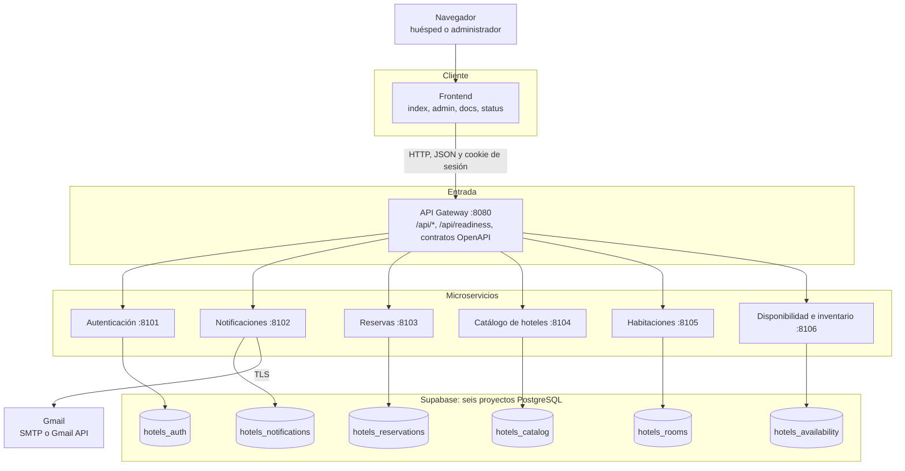
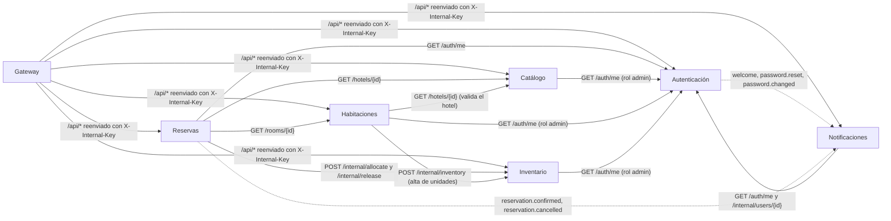
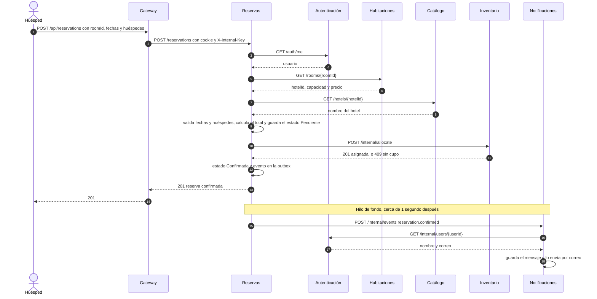
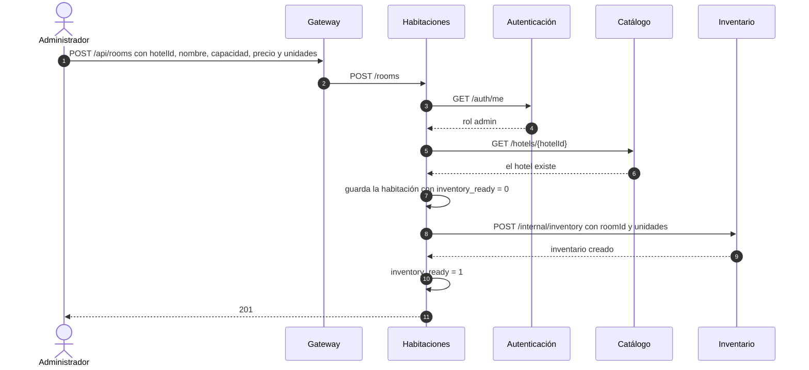
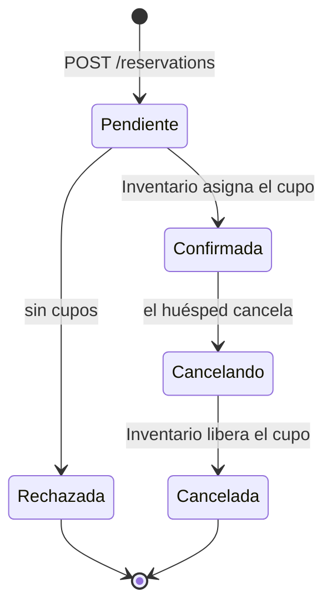
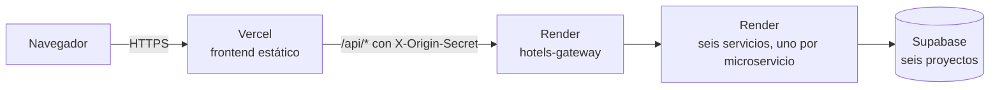

# 1. Arquitectura

Este documento contiene el **diagrama general de arquitectura** y el **diagrama de comunicación entre microservicios** que pide la guía. Los diagramas están en Mermaid; GitHub los dibuja al abrir el archivo.

## 1.1 Visión general

Hotels es un sistema de reservas hoteleras para Montería. Un huésped consulta hoteles y habitaciones, revisa la disponibilidad por fechas, crea una cuenta, reserva, recibe la confirmación por correo y puede cancelar. Un administrador gestiona hoteles, habitaciones, inventario y huéspedes desde un panel.

La solución tiene tres capas:

- **Frontend:** HTML, CSS y JavaScript sin framework. En local lo sirve el Gateway; en la nube lo publica Vercel.
- **API Gateway:** único punto de entrada de las APIs. Recibe las llamadas `/api/*` y las reenvía al microservicio dueño de cada dominio.
- **Seis microservicios:** cada uno es un proceso Python independiente, con su propio puerto y su propia base de datos PostgreSQL en un proyecto Supabase distinto.

## 1.2 Diagrama general de arquitectura

**Lectura del diagrama:**

- El navegador solo conoce el Gateway. Nunca llama directamente a un microservicio.
- Cada microservicio lee y escribe únicamente en su base. Ninguno tiene la credencial de la base de otro.
- Las seis bases son proyectos Supabase separados, no esquemas de una misma base. Si una URL de base se deja vacía en local, ese servicio usa SQLite; así funcionan las pruebas automáticas.
- Solo Notificaciones tiene credenciales de correo.

## 1.3 Diagrama de comunicación entre microservicios

**Línea continua:** llamada síncrona HTTP con JSON. El servicio que llama espera la respuesta.

**Línea punteada:** comunicación asíncrona con el patrón outbox. El evento se guarda en la tabla `outbox` del emisor, en la misma transacción que el cambio de negocio. Un hilo de fondo lo entrega a `POST /internal/events` de Notificaciones y lo reintenta si falla. Ver la decisión D6 en [04-decisiones-tecnicas.md](04-decisiones-tecnicas.md).

**Validación de sesión y rol:** ningún servicio confía en un rol enviado por el navegador. Cada operación protegida pregunta a Autenticación con `GET /auth/me`, reenviando la cookie del usuario.

## 1.4 Flujo de negocio principal: crear una reserva

**Si Inventario no responde** en el paso 10, la reserva queda en **Pendiente** y la API devuelve **202**. Un reconciliador de Reservas reintenta cada 2 segundos y la pasa a **Confirmada** o **Rechazada** cuando Inventario vuelve.

**La cancelación** sigue el mismo camino: Reservas marca **Cancelando**, llama a `POST /internal/release` y pasa a **Cancelada**. Si Inventario no responde, queda en **Cancelando** hasta que el reconciliador la completa.

## 1.5 Flujo de administración: alta de una habitación

Si Inventario no responde, la habitación queda guardada pero **no se ofrece al público** y la API devuelve **202**. Un hilo de Habitaciones reintenta hasta crear el inventario.

## 1.6 Estados de una reserva

## 1.7 Despliegue

**Local en Windows:** `INICIAR.cmd` ejecuta `start.py`, que inicia los seis servicios, espera su `/health`, ejecuta la reconciliación de Reservas y después abre el Gateway en el puerto 8080. Mientras la versión publicada esté activa, la copia local debe usar SQLite (URLs de base vacías): si usara las mismas bases de Supabase, sus hilos de fondo procesarían las mismas colas que Render.

**Docker Compose:** `compose.yaml` define siete contenedores (Gateway y seis servicios) a partir de un solo `Dockerfile`. Solo el Gateway publica un puerto. Cada contenedor recibe solo su conexión de base. GitHub Actions lo construye y prueba en cada cambio (`tests/compose.py`).

**Nube (publicado):** https://hotels-monteria-dodyce.vercel.app/

- `vercel.ts` publica el frontend y reenvía `/api/*` al Gateway con una cabecera secreta. Así las cookies quedan en el dominio del frontend.
- `render.yaml` declara siete servicios gratuitos, cada uno con su contenedor y su `/health`. En Render cada microservicio tiene su propia URL y solo acepta llamadas con la clave interna; el Gateway solo acepta llamadas que vienen de Vercel.
- Los seis servicios se conectan a sus seis bases de Supabase. Cada uno recibe únicamente su propia cadena de conexión.
- En el plan gratuito, un servicio sin uso se duerme y el Gateway no alcanza a despertarlo dentro de su tiempo de espera: hay que llamar directamente a su `/health` (ver la parte E del manual).
- En Render, Notificaciones usa Gmail API por HTTPS porque el plan gratuito bloquea los puertos SMTP.

Ver [08-manual-instalacion-y-usuario.md](08-manual-instalacion-y-usuario.md).
