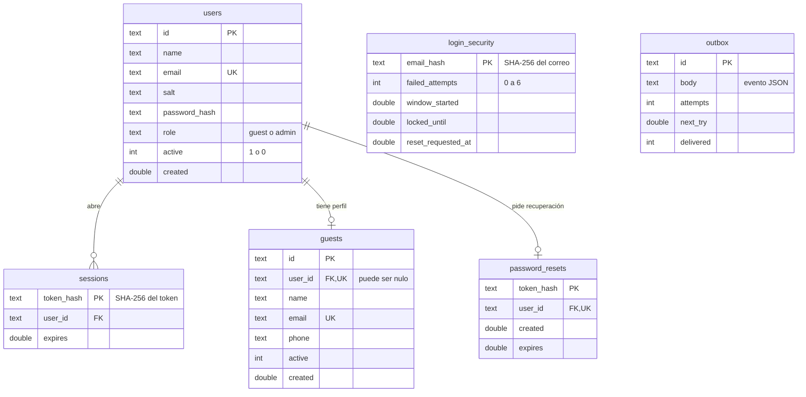
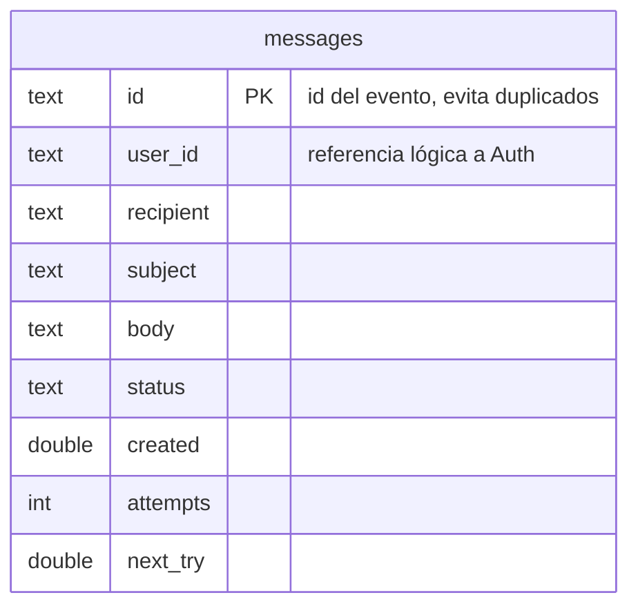
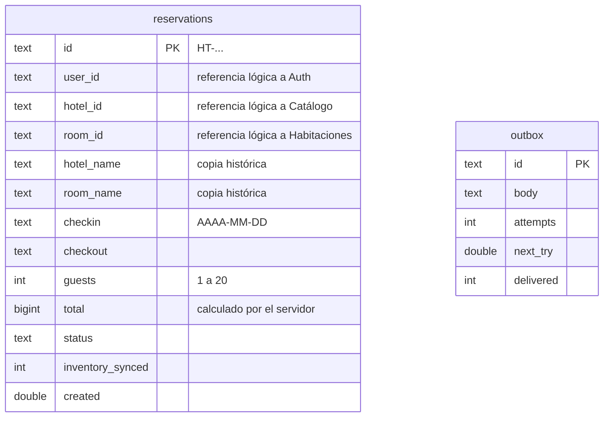
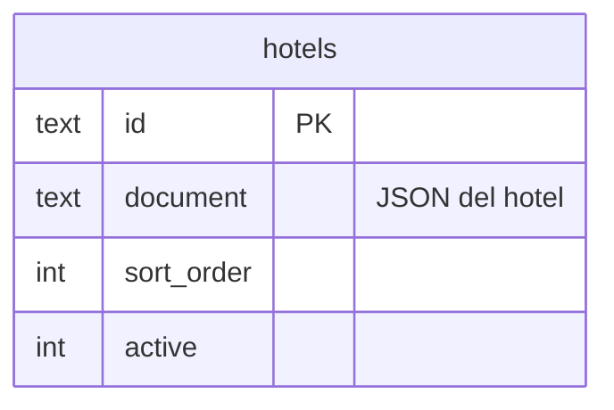
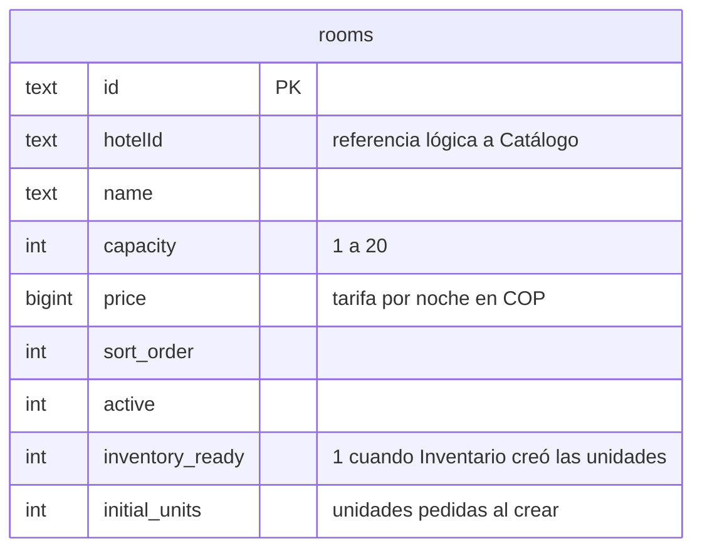
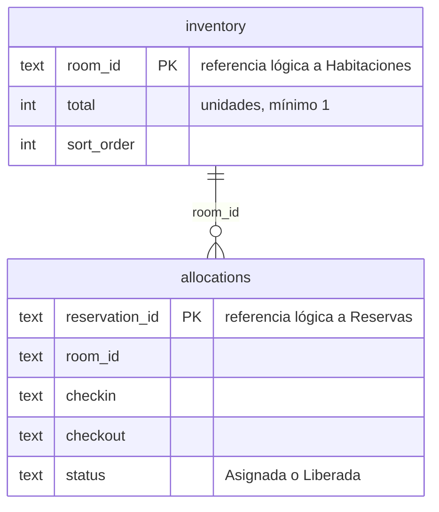
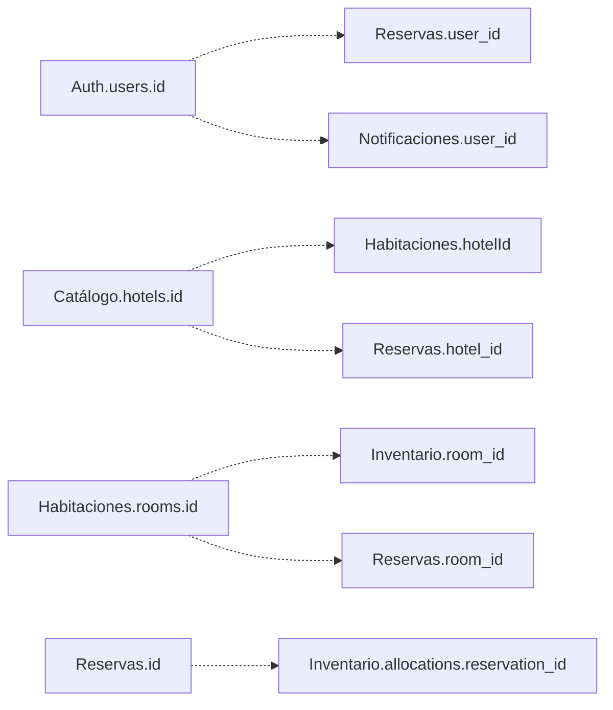

# 3. Modelo de datos por servicio

Cada microservicio tiene **su propia base PostgreSQL** en un proyecto Supabase distinto. Ningún servicio lee tablas de otro. Las referencias entre dominios (por ejemplo, `user_id` en Reservas) son identificadores de texto que se resuelven por API, sin claves foráneas entre bases.

Las tablas viven en un esquema privado por servicio (`hotels_auth`, `hotels_catalog`, etc.), con RLS activo y un rol técnico propio. Las migraciones SQL están en `migrations/<servicio>/`. En local, si la URL de una base está vacía, el servicio crea las mismas tablas en SQLite.

Cada base tiene además `hotels_meta.service_owner`, una fila que indica a qué servicio pertenece. Si se apunta un servicio a la base de otro, la inicialización falla.

## 3.1 Autenticación (`hotels_auth`)

- **users:** credenciales. La contraseña se guarda como scrypt con sal propia, nunca en texto.
- **sessions:** solo se guarda el hash del token; la cookie lleva el token. Duran ocho horas.
- **guests:** perfil del huésped que gestiona el administrador. Puede existir sin cuenta.
- **login_security:** contador de intentos fallidos por correo, para el bloqueo temporal.
- **password_resets:** un token vigente por usuario, válido 15 minutos.
- **outbox:** eventos pendientes de entregar a Notificaciones.

## 3.2 Notificaciones (`hotels_notifications`)

- El `id` es el identificador del evento. Si el mismo evento llega dos veces, no se crea otro mensaje.
- `status` toma: `vista_previa`, `pendiente`, `reintentando`, `aceptado_smtp`, `aceptado_api`, `error` y `caducado` (enlace de recuperación vencido antes de enviarse).

## 3.3 Reservas (`hotels_reservations`)

- `status` solo admite `Pendiente`, `Confirmada`, `Cancelando`, `Cancelada` y `Rechazada`.
- Se guardan nombre del hotel, nombre de la habitación y total como copia. Si el catálogo cambia después, la reserva conserva lo que el huésped contrató.
- `inventory_synced` indica si Inventario ya confirmó la asignación o la liberación.

## 3.4 Catálogo de hoteles (`hotels_catalog`)

`document` es un JSON validado por el servicio con: `id`, `name`, `city`, `area`, `address`, `description`, `badge`, `tags`, `amenities`, `image`, `photographer`, `photoPage` y `source`. Se eligió un documento porque los hoteles tienen listas (servicios, comodidades) que no se consultan por separado. Una restricción de la base exige que el `id` del JSON coincida con el de la fila.

## 3.5 Habitaciones (`hotels_rooms`)

Índice por `hotelId` y `capacity` para el filtro de búsqueda.

## 3.6 Disponibilidad e inventario (`hotels_availability`)

- Una unidad está ocupada en una noche si existe una asignación `Asignada` que cubre esa noche. La fecha de salida no ocupa noche.
- Índice por `room_id`, `status`, `checkin` y `checkout` para calcular la disponibilidad en una sola consulta.
- Una asignación `Liberada` no se puede volver a asignar; así una petición tardía no reactiva una reserva cancelada.

## 3.7 Referencias entre dominios

Las líneas punteadas son referencias lógicas. Las valida el servicio por API en el momento de crear el registro: Habitaciones consulta Catálogo antes de crear un tipo, y Reservas consulta Habitaciones y Catálogo antes de reservar.

## 3.8 Datos iniciales

`seed/hotels.json`, `seed/rooms.json` y `seed/inventory.json` cargan tres hoteles de referencia en Montería, seis tipos de habitación (dos por hotel) y una unidad por tipo. Cada archivo inicializa solo su servicio y no sobrescribe registros existentes.
